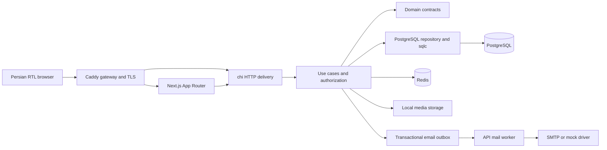

# Architecture

ExpertsAcademy is a Persian publication with a Go API and a Next.js 15.5.27 frontend. PostgreSQL 16 is the durable source of truth. Redis provides short-lived caches, a view ranking mirror, and atomic rate limiting. Next.js accesses the versioned API and never connects directly to PostgreSQL.

Endpoint details and request payloads are maintained in the [API reference](API_REFERENCE.md). Deployment settings are maintained in [operations](OPERATIONS.md).

## Service boundaries



Caddy routes `/api/v1/*` directly to Go and other paths to Next.js. Next.js server fetches use `API_INTERNAL_URL`; browser fetches remain same-origin. In native development, Next.js rewrites `/api/v1/*` to Go. API health endpoints are internal and are not routed through the public gateway.

## Code layout

```text
apps/api/
  cmd/api/                  Dependency composition, worker, graceful shutdown
  cmd/admin/                Explicit administrator bootstrap
  internal/domain/          Models, errors, dependency interfaces
  internal/usecase/         Auth, authorization, content, media, comments
  internal/repository/      PostgreSQL mapping, transactions, local media
    db/                     Generated sqlc code; do not edit manually
  internal/delivery/http/   Routes, strict JSON, cookies, JWT, Origin, logs
  internal/platform/        Configuration, Redis, site revalidation
  pkg/mailer/               SMTP with mandatory STARTTLS and mock driver
  db/schema.sql             Current schema snapshot
  db/migrations/            Numbered golang-migrate up/down files
  db/queries/blog.sql       Typed query sources
  sqlc.yaml                 pgx/v5 generation configuration
apps/web/
  app/                      Publication, article, studio, metadata and feeds
  components/               Editor, password controls, comments and account UI
  lib/                      API client, types, editor documents, safe HTML, SEO
  tests/                    Frontend behavior and helper tests
  public/                   Local OpenGraph image and SVG source
```

Domain contracts have no framework dependency. Use cases enforce business rules through these interfaces. Repositories map sqlc results into domain models and translate database errors. HTTP delivery handles transport and sessions. Saving an article and replacing its tags is transactional: an invalid tag rolls back the entire save.

## Database and migrations

The seven application tables are users, posts, categories, tags, post_tags, comments, and email_outbox. UUIDs identify records. `citext` provides case-insensitive email uniqueness. Database checks constrain roles and statuses. A composite foreign key on `(parent_id, post_id)` prevents cross-article comment replies.

Partial publication and popularity indexes cover public posts. Category, tag, and comment indexes support filtering and tree traversal. GIN trigram indexes support substring search; a `simple` text-search index is also present for future full-text work. The current suggestion query uses escaped `ILIKE`, not a Persian stemming engine. Search normalizes Arabic variants of yeh and kaf to Persian equivalents, accepts 2–100 Unicode characters, and returns up to eight results.

| Migration                      | Change                                                  |
| ------------------------------ | ------------------------------------------------------- |
| `000001_init`                  | Initial tables, constraints, extensions, and indexes    |
| `000002_editorial_permissions` | Disabled accounts and archived/deleted article statuses |
| `000003_post_cover`            | Nullable cover image URL                                |

Mixed content blocks use the existing JSON column and require no new migration. Keep `schema.sql`, migrations, query sources, and sqlc output consistent. CI uses sqlc 1.30.0 and rejects generated-code drift. Down migrations are for controlled rollback or disposable tests: the initial down migration drops application tables, while the editorial rollback converts newer statuses to private drafts. Extensions are retained during rollback.

## Accounts and authorization

Public signup creates `author` accounts. Only the administrator CLI creates an administrator. Passwords use bcrypt cost 12 and must contain 12–72 UTF-8 bytes at the API boundary. The registration UI additionally checks matching confirmation and a minimum length of 12 JavaScript string units; confirmation is never sent to the API. The login and registration eye buttons change field visibility only.

Sessions are HS256 JWTs with an eight-hour expiry, issuer `expertsacademy-api`, and audience `expertsacademy-web`. The `ea_session` cookie is HttpOnly, SameSite=Lax, and Secure in production. Bearer authentication is supported, but login/signup return the user and set a cookie rather than returning a token field. Each authenticated request reloads the user from PostgreSQL, so disabling an account blocks subsequent requests and login.

All writes require an exact matching `Origin`, including Bearer requests and multipart uploads. JSON writes reject unknown fields, trailing JSON documents, and bodies above 1 MiB. Invalid browser cookies are cleared on public reads, which continue as guest requests; explicit invalid Bearer credentials and protected operations fail with 401. Logout clears the browser cookie. There is no token revocation store: a copied token remains usable until expiry unless the account is disabled or the signing key changes.

Authors manage only their own active articles. Administrators manage all articles, taxonomy, authors, and comments. Editing another person's article preserves its author. Disabling an author does not hide that author's published articles. Archive and soft-delete operations exclude articles from public queries; restoration always produces a private draft. SQL save guards reject archived/deleted records, including races with stale editor forms.

## Editor documents and rendering

The editor represents content as ordered text, image, and link blocks in either `plain_text` or `html` format. The API validates at most 200 blocks and a combined 500,000 bytes of text, URLs, and alternative text. Managed image widths are integers from 80 to 2,000 pixels. Uploaded images must exist and belong to the article's author or the acting author; administrators may reuse other accounts' uploads. Managed links accept HTTP/HTTPS URLs or root-relative paths, excluding credentials, protocol-relative addresses, backslashes, and control characters.

The server creates `content_json` version 2 with the format, an empty `content` string, and validated blocks. Plain text is escaped with paragraph and line-break handling. HTML text blocks are combined with generated image/link markup, then sanitized with Bluemonday. Original HTML block strings are stored for editing and must not be rendered directly. Public pages and editor previews sanitize rendered HTML again with `sanitize-html`. CSS constrains images to available width and preserves aspect ratio.

Compatibility paths remain available: explicit `content_format` with `content_text` or `content_html` creates a version 1 editor document. Clients omitting the format retain the older sanitized HTML plus client JSON behavior. Legacy articles open as a text block in the new editor. Raw HTML image tags remain editable in HTML source; they do not automatically become managed resize controls.

Publishing requires text remaining after sanitization; an image-only article is rejected. Reading time is rounded up at 200 words per minute with a minimum of one minute. Republish retains the original first publication date. The editor has no autosave. Hidden tab panels preserve unsaved state within the page; uploads and saves lock relevant controls, and an unfinished link panel blocks saving until completed or canceled.

## Media storage

The upload endpoint accepts one PNG/JPEG image, validates actual decoder output, and enforces 5 MiB input and output limits, at most 12 million pixels, and at most 8,000 pixels on either axis. The multipart request has a separate 64 KiB overhead allowance. Two decode slots bound simultaneous processing per API process. Re-encoding strips metadata and appended payloads.

`LocalMedia` uses an account UUID namespace and a generated file UUID, temporary writes, and atomic rename. Client filenames are not used. The API container runs as UID 10001; Compose mounts `uploads_data` at `/data/uploads`. Upload URLs are public and have a one-year immutable cache policy, including files associated with drafts or unsaved articles. Media is not confidential storage. Removing a cover or block removes its reference, not its file; no garbage collector is implemented.

Covers are optional and appear on cards, articles, OpenGraph, Twitter, and JSON-LD. Next/Image optimizes local cover images. Inline images use their width attributes and responsive CSS. Database dumps do not contain uploaded bytes; both stores must be backed up together.

## Comments and email

A recursive SQL query starts at approved roots and traverses only approved children. The result is built into a tree in O(n), without N+1 database queries. A comment is visible only when its full ancestor chain is approved. Marking a parent as spam or pending hides the whole branch. Parents are immutable; cross-article references and depth beyond eight levels are rejected. Public trees are currently unpaginated.

Every comment, including those from administrators and authors, starts pending. A new comment and its notification to the article author are committed in one transaction. Approving a reply and queuing a notification to its parent commenter are also transactional. Repeating approval while already approved does not enqueue another notification; moving out of approved and approving again can do so. Comment emails and password hashes are excluded from JSON responses.

The mail worker polls every two seconds and claims up to 20 jobs per cycle. Atomic updates with `FOR UPDATE SKIP LOCKED` grant five-minute leases, allowing multiple workers. Each attempt has a 20-second timeout, and jobs stop being retried after 12 attempts. Delivery is at least once: SMTP success followed by failure to record `sent_at` can produce a duplicate. A stable job-based Message-ID helps identify repeats. SMTP requires STARTTLS; implicit TLS on port 465 is unsupported. Mock mail logs job IDs rather than recipients or message bodies, and is rejected in production.

## Caching, revalidation, and view counts

| Layer                                 | Behavior                                                                           |
| ------------------------------------- | ---------------------------------------------------------------------------------- |
| PostgreSQL views                      | Atomic lifetime count; durable                                                     |
| Redis ranking                         | ZSET mirror with `ZADD GT` to prevent older concurrent scores replacing newer ones |
| Redis suggestions/popular             | 20-second TTL, revision namespacing after article changes                          |
| Next.js article and post list fetches | 60-second revalidation; tagged by article slug or `posts`                          |
| Next.js popular fetch                 | 30-second revalidation; tagged `posts`                                             |
| Next.js taxonomy fetch                | 60-second revalidation; no article cache tag                                       |

Popular results are read from PostgreSQL and cached; they are lifetime rankings, not weekly or unique-visitor counts. Server-rendered article fetches use `count_view=false`. The browser sends a countable detail request after 800 ms. Ordinary detail GETs count as views, including automated clients.

Articles use `generateStaticParams=[]` and 60-second ISR. Metadata and page content share a memoized loader. A successful save or status change asks the web service to revalidate old/new slugs, `posts`, the home page, sitemap, and RSS. The independent private `REVALIDATION_SECRET` is compared in constant time by `POST /api/revalidate`. A failed webhook logs a warning without undoing a committed article; periodic revalidation remains a fallback. Cached pages may outlive a publication status change, particularly during upstream failure; ISR is unsuitable for confidential content.

Article slugs are decoded and validated before building an API URL, then encoded once. This avoids double-encoding Persian paths. Changing a slug invalidates its cached paths but does not create an automatic redirect or update existing links.

## Rate limiting and dependency failures

Redis Lua scripts implement per-IP buckets: 180 reads, 20 non-auth writes, and eight auth POSTs per minute. A rate rejection includes `Retry-After: 60`. The limiter has a 500 ms dependency deadline. If Redis fails, reads may continue against PostgreSQL; writes return 503. API readiness still reports Redis failure.

Only peers matching `TRUSTED_PROXY_CIDRS` may provide forwarded addresses; the implementation uses the last `X-Forwarded-For` value. Compose trusts its dedicated `172.30.58.0/24` network and exposes only Caddy. A CDN or additional reverse proxy needs deliberate forwarding configuration. Server-side Next.js requests can share one source IP and therefore the read bucket; large sitemap generation or concurrent cache misses can reach that limit.

## Frontend and SEO

The root uses `lang=fa` and `dir=rtl`, logical spacing, locally hosted Vazirmatn, and persisted light/dark preferences. Public search debounces for 250 ms, aborts obsolete requests, and closes with Escape. The editor's internal-link search uses a 300 ms debounce and published article suggestions.

Article metadata includes canonical URLs, OpenGraph, Twitter, and escaped JSON-LD. Structured-data author and publisher currently identify the ExpertsAcademy organization rather than individual authors. There are no dedicated public author profile pages. RSS contains the latest 50 published articles, and the sitemap paginates through public articles in batches of 50. Robots disallows the studio and API; studio metadata is noindex/nofollow. These crawler directives do not enforce access control.

## Observability and scaling limits

Structured JSON request logs include request ID, route, method, status, and duration. Request bodies, passwords, and guest comment emails are not part of those request logs. `/healthz` checks process liveness; `/readyz` checks PostgreSQL and Redis. HTTP timeouts, pool limits, and graceful shutdown are configured.

Studio articles are limited to the newest 200 non-deleted records, with a separate 200-record trash query. Archive/ownership filters are client-side within that set. Comment moderation returns the oldest 200 in each status; author accounts are paginated. Pagination, shared media storage, coordinated cache invalidation across web replicas, and server-rendered rate-limit handling need further work for larger or multi-host deployments. See [verification](VERIFICATION.md) for actual test evidence and [operations](OPERATIONS.md) for deployment procedures.
