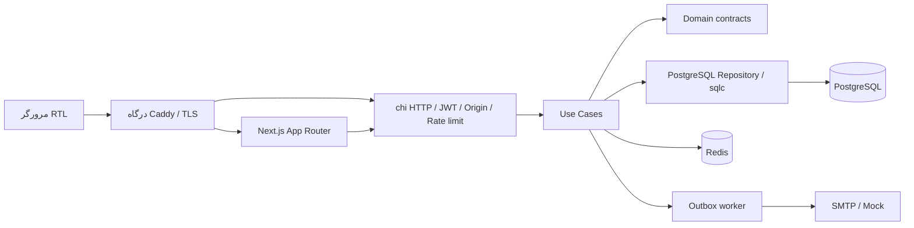

# معماری وبلاگ ExpertsAcademy

## مرزهای سیستم

دادهٔ ماندگار در PostgreSQL 16 است. Redis برای کش کوتاه‌مدت پیشنهادها و محبوب‌ها، Sorted Set رتبهٔ بازدید و rate limit اتمیک استفاده می‌شود. Next.js 15.5.27 فقط از API نسخه‌دار استفاده می‌کند و دسترسی مستقیم به دیتابیس ندارد. دامنهٔ عملیاتی `https://blog.expertsacademy.ir` است.



## چیدمان پوشه‌ها

```text
apps/api/
  cmd/api/                  composition root و graceful shutdown
  cmd/admin/                ساخت صریح مدیر، خارج از signup
  internal/domain/          مدل‌ها، خطاهای کاربردی و قراردادهای وابستگی
  internal/usecase/         مجوزها، انتشار، احراز هویت، نظرات، اعلان‌ها
  internal/repository/      نگاشت مدل‌ها، تراکنش و خطاهای PostgreSQL
    db/                     کد تولیدشده توسط sqlc؛ ویرایش دستی ممنوع
  internal/delivery/http/   مسیرها، DTO ورودی، کوکی، JWT، CORS و لاگ
  internal/platform/        تنظیمات و آداپتور Redis
  pkg/mailer/               SMTP با STARTTLS اجباری و Mock
  db/schema.sql             تصویر آخرین ساختار
  db/migrations/            up/down قابل اجرا با golang-migrate
  db/queries/blog.sql       منبع کوئری‌های تایپ‌سیف
  sqlc.yaml                 تنظیمات تولید pgx/v5
apps/web/
  app/                      مجله، مقاله، studio، RSS، sitemap و robots
  components/               UI مجله، جستجو، تم و نظرات
  lib/                      قراردادهای TypeScript، API client و SEO
  public/                   تصویر OpenGraph و منبع SVG آن
```

Domain به هیچ framework وابسته نیست. Use Case از interfaceهای Domain استفاده می‌کند. Repository خروجی sqlc را به مدل‌های دامنه نگاشت می‌کند. HTTP فقط دریافت ورودی، نشست و تبدیل خطا به پاسخ را بر عهده دارد. `cmd/api` وابستگی‌ها را به هم متصل می‌کند. ثبت مقاله و تگ‌ها یک تراکنش است؛ خطای تگ باعث rollback تمام تغییر مقاله می‌شود.

## دیتابیس و migration

`citext` یکتایی ایمیل را بدون حساسیت به بزرگی حروف تأمین می‌کند. شناسه‌ها UUID v4 هستند. `pg_trgm` برای جستجوی زیررشتهٔ فارسی و فهرست پیشنهادها به کار می‌رود. نقش و وضعیت با CHECK در دیتابیس محدود می‌شوند؛ ایمیل نویسنده و مهمان هرگز از پاسخ عمومی کامنت خارج نمی‌شود. FK ترکیبی `(parent_id, post_id)` نمی‌گذارد پاسخ متعلق به مقالهٔ دیگری باشد.

ایندکس‌های جزئی انتشار و محبوبیت فقط مقاله‌های منتشرشده را پوشش می‌دهند. ایندکس category و post_tags برای فیلترها، و ایندکس‌های post/status/created_at و parent برای نظرات هستند. عنوان و HTML دارای GIN trigram هستند. یک GIN روی `to_tsvector('simple', title || ' ' || content_html)` نیز برای توسعهٔ جستجوی full-text وجود دارد. `simple` ریشه‌یاب فارسی نیست؛ suggestion فعلی از ILIKE با escape کردن `%` و `_` استفاده می‌کند. ورودی و عنوان با تبدیل «ي/ك» به «ی/ک» نرمال می‌شوند. حداقل جستجو ۲ حرف، حداکثر ۱۰۰ حرف و حداکثر پاسخ ۸ مقاله است.

تغییر schema باید هم در migration جدید و هم در `schema.sql` اعمال شود. پس از تغییر کوئری:

```bash
cd apps/api
sqlc generate
```

نسخهٔ مولد 1.30.0 است؛ CI اختلاف کد تولیدشده با فایل‌های commit شده را رد می‌کند. Migration اولیه برگشت‌پذیر است، اما down آن تمام داده‌های برنامه را حذف می‌کند؛ rollback پروداکشن باید با پشتیبان و تصمیم عملیاتی انجام شود. اکستنشن‌ها در down حذف نمی‌شوند چون ممکن است مصرف‌کنندهٔ دیگری داشته باشند.

## قرارداد HTTP

تمام مسیرها با `/api/v1` آغاز می‌شوند. JSON UTF-8 است. تاریخ‌ها RFC3339 و IDها UUID هستند. فهرست خالی `[]` برمی‌گردد. پاسخ خطا به شکل زیر است:

```json
{"error":{"code":"invalid_input","message":"اطلاعات واردشده معتبر نیست."}}
```

وضعیت‌ها: 400 ورودی نامعتبر، 401 نشست نامعتبر، 403 مجوز/Origin، 404 رکورد غیرقابل‌دسترسی، 409 تضاد یکتایی/ارتباط، 429 محدودیت نرخ، 503 ناتوانی در محدودسازی نوشتن و 500 خطای داخلی. جزئیات SQL در پاسخ افشا نمی‌شود. حداکثر بدنه ۱ MiB است؛ فیلد اضافی یا چند سند JSON پذیرفته نمی‌شود.

### احراز هویت

- `POST /auth/signup`: `{email,password}`؛ ثبت‌نام عمومی بدون دعوت، رمز ۱۲–۷۲ **بایت** و نقش خروجی همواره `author` است. `name` اختیاری با طول ۲–۱۰۰ حرف است؛ در صورت نبودن، نام نمایشی «نویسنده» ذخیره می‌شود.
- `POST /auth/login`: `{email,password}`؛ پاسخ User و کوکی `ea_session`.
- `POST /auth/logout`: حذف کوکی، پاسخ 204.
- `GET /auth/me`: مشخصات نشست نویسنده/مدیر؛ hash هرگز برگردانده نمی‌شود.

JWT امضاشده با HS256، audience و issuer ثابت و انقضای ۸ ساعت است. کوکی HttpOnly، SameSite=Lax و در production Secure است. نقش از دیتابیس خوانده می‌شود، نه از ادعای کلاینت. Bearer نیز برای کلاینت‌های API قابل استفاده است. درخواست‌های نوشتن حتی با Bearer باید هدر `Origin` برابر `CORS_ORIGIN` و Content-Type JSON داشته باشند. در محیط production از یک origin و TLS استفاده می‌شود. logout کوکی مرورگر را پاک می‌کند؛ توکن کپی‌شده تا انقضا معتبر می‌ماند. rotation کلید JWT تمام نشست‌ها را بی‌اعتبار می‌کند. کوکی نامعتبر در خواندن عمومی پاک می‌شود و درخواست به‌صورت مهمان ادامه می‌یابد؛ عملیات نوشتن، پنل و Bearer نامعتبر همچنان 401 می‌دهند.

### مجلهٔ عمومی

- `GET /posts?page=1&limit=12&category=engineering&tag=go`: فیلترها **slug** هستند. limit از ۱ تا ۵۰ و page از ۱ تا ۱۰۰۰۰. خروجی `{items,total,page,limit}`. ترتیب انتشار و ID نزولی، فقط published و published_at گذشته. بدنهٔ محتوا از فهرست حذف می‌شود.
- `GET /posts/popular`: حداکثر ۶ مقاله، مرتب بر اساس بازدید انباشتهٔ تمام عمر. این رتبه‌بندی پنجرهٔ هفتگی نیست.
- `GET /posts/search-suggest?q=...`: حداکثر ۸ مقاله، اولویت تطابق عنوان و سپس بازدید؛ نتایج کوتاه بدون بدنهٔ HTML.
- `GET /posts/{slug}`: مقاله و تگ‌ها همراه افزایش اتمیک `views_count`. `?count_view=false` برای واکشی SSR، SEO و پیش‌نمایش بدون افزایش بازدید است.
- `GET /taxonomy`: `{categories:[],tags:[]}` برای فیلتر و ویرایشگر.
- `GET /posts/{id}/comments`: آرایهٔ ریشه‌ها با `replies` بازگشتی؛ فقط زنجیره‌های کاملاً تأییدشده.
- `POST /posts/{id}/comments`: `{author_name,author_email,content,parent_id}`؛ parent_id برابر null یا ID نظر تأییدشدهٔ همین مقاله. متن ۲–۵۰۰۰ حرف، نام ۲–۱۰۰ حرف و ایمیل معتبر. خروجی 201 با status=pending. برای نشست معتبر، نام و ایمیل از حساب خوانده می‌شوند.

نمای عمومی Comment: `id,post_id,user_id?,parent_id,author_name,content,status,created_at,updated_at,replies`. ایمیل فقط در دیتابیس و مسیر ارسال ایمیل استفاده می‌شود.

### پنل تحریریه

- `GET /studio/posts`: تا ۲۰۰ مقالهٔ آخر و فعال نویسنده؛ مدیر مقاله‌های همهٔ حساب‌ها و آرشیو را می‌بیند. مقاله‌های حذف‌شده در `GET /studio/posts?status=deleted` فقط برای مدیر دریافت می‌شوند.
- `POST /studio/posts`: ایجاد یا ویرایش. `id` خالی یعنی ایجاد؛ ID موجود فقط برای مالک یا مدیر قابل ویرایش است. فیلدها: `id,category_id,slug,title,content_format,content_text,content_html,content_json,cover_image_url,excerpt,status,tag_ids`.
- `GET /studio/comments?status=pending`: تا ۲۰۰ نظر قدیمی در وضعیت pending (پیش‌فرض)، approved یا spam؛ فقط مدیر مجاز است و نظرات همهٔ مقاله‌ها را می‌بیند.
- `PATCH /studio/comments/{id}`: `{status:"approved"}` یا `spam` یا `pending`. فقط مدیر مجاز است. تغییر همزمان با قفل رکورد سریالی می‌شود.
- `POST /studio/media`: مدیر و نویسنده؛ multipart/form-data با یک فایل `image`. PNG/JPEG، حداکثر ۵MiB و ۱۲ میلیون پیکسل؛ خروجی 201 `{url,width,height}`. نام فایل UUID در namespace حساب است؛ هیچ filename ارسالی کلاینت استفاده نمی‌شود.
- `GET /media/{owner}/{file}`: خواندن تصویر ثابت و عمومی با MIME مشخص، nosniff و کش immutable. رسانهٔ پیش‌نویس نیز با داشتن URL قابل خواندن است؛ این مسیر برای رسانهٔ محرمانه نیست.
- `GET /studio/authors?page=1&limit=20`: فقط مدیر؛ خروجی `{items,total,page,limit}` و حساب‌های author؛ limit حداکثر ۵۰. hash رمز در JSON وجود ندارد.
- `POST /studio/authors`: فقط مدیر؛ `{name,email,password}`، خروجی 201 حساب نویسنده بدون تغییر کوکی نشست مدیر.
- `PATCH /studio/authors/{id}`: فقط مدیر؛ `{name,email,disabled}`. شرط `role='author'` در SQL مانع تغییر حساب مدیر می‌شود؛ غیرفعال‌کردن حساب با `disabled_at` و بررسی آن در login و هر درخواست JWT اعمال می‌شود.
- `PATCH /studio/posts/{id}/status`: فقط مدیر؛ `{status:"archived"}` یا `{status:"draft"}`. آرشیو از نمایش عمومی خارج می‌شود؛ بازگردانی همواره پیش‌نویس است.
- `DELETE /studio/posts/{id}`: فقط مدیر؛ خروجی 204، حذف نرم با status=deleted؛ محتوا، کامنت‌ها و برچسب‌ها حفظ می‌شوند.
- `POST /studio/taxonomy/categories` و `/studio/taxonomy/tags`: `{name,slug}`؛ فقط مدیر.

نقش نویسنده به ایجاد، ویرایش و انتشار مقالهٔ خودش محدود است؛ مدیریت نویسندگان، نظرات، taxonomy، آرشیو، حذف و سطل حذف مخصوص مدیر است. ایجاد مقاله توسط مدیر، author_id خود مدیر را ثبت می‌کند؛ ویرایش مقالهٔ دیگران مالکیت آن را تغییر نمی‌دهد. تغییر وضعیت در یک UPDATE اتمیک انجام و revision کش invalid می‌شود. SavePost در SQL اجازهٔ تغییر رکورد archived/deleted را نمی‌دهد تا فرم قدیمی یا رقابت درخواست‌ها نتواند تصمیم مدیر را دور بزند. migration شمارهٔ ۲ بدون حذف داده، وضعیت‌ها و disabled_at را اضافه می‌کند؛ rollback وضعیت‌های جدید را به draft خصوصی تبدیل می‌کند.

slug از حروف Unicode، عدد و خط تیره تشکیل می‌شود؛ عنوان حداکثر ۲۴۰ حرف، خلاصه ۵۰۰ حرف، HTML حداکثر ۵۰۰ هزار بایت و تگ‌ها حداکثر ۲۰ شناسهٔ یکتا هستند. `content_format` برابر `plain_text` یا `html` است؛ نبودن آن برای سازگاری با کلاینت‌های قبلی HTML در نظر گرفته می‌شود. در حالت plain_text ورودی `content_text` توسط سرور escape و به پاراگراف/شکست خط تبدیل می‌شود. در حالت html ورودی `content_html` با Bluemonday پاک‌سازی می‌شود. برای قالب صریح، سرور `content_json={version:1,format,content}` را می‌سازد و به metadata ارسالی کلاینت اعتماد نمی‌کند؛ source متن ساده و HTML پاک‌سازی‌شده برای ویرایش بعدی نگهداری می‌شوند. انتشار متن خالی بعد از پاک‌سازی رد می‌شود. زمان مطالعه با ۲۰۰ واژه در دقیقه و حداقل ۱ دقیقه محاسبه می‌شود. تغییر status به draft دسترسی عمومی API را قطع می‌کند؛ کش ISR ممکن است تا دور بازاعتبارسنجی بعدی نسخهٔ قبلی را نشان دهد.

## درخت نظرات

کوئری `WITH RECURSIVE tree` از ریشه‌های approved در یک مقاله شروع می‌کند و به فرزندانی می‌رسد که خودشان approved هستند. نتیجه در یک round trip دریافت می‌شود؛ N+1 وجود ندارد. Use Case با نگاشت ID به اشاره‌گر، در زمان O(n) ساختار `replies` را تشکیل می‌دهد. ترتیب فرزندان بر اساس created_at و ID پایدار است.

parent پس از ایجاد قابل تغییر نیست؛ API نمی‌تواند چرخه ایجاد کند. پیش از reply، کوئری بازگشتی ancestors عمق را محاسبه می‌کند. حداکثر عمق ۸ سطح، شامل ریشه است. UI نیز در سطح هشتم دکمهٔ پاسخ نشان نمی‌دهد. spam شدن ریشه، کل شاخهٔ فرزندان آن را از خروجی عمومی پنهان می‌کند. برای نمایش کامل تاریخچه، فعلاً صفحه‌بندی درخت وجود ندارد؛ پیش از مقیاس بسیار بزرگ، سیاست صفحه‌بندی ریشه‌ها را اضافه کنید.

## ایمیل و دوام

ثبت نظر و اعلان نویسنده در یک تراکنش انجام می‌شود. تأیید پاسخ و اعلان به ایمیل والد نیز یک تراکنش است. تغییر تکراری approved در همان وضعیت، job تکراری نمی‌سازد. worker هر ۲ ثانیه حداکثر ۲۰ job می‌گیرد. `FOR UPDATE SKIP LOCKED` همراه UPDATE اتمیک، lease پنج‌دقیقه‌ای می‌سازد؛ چند replica می‌توانند صف را پردازش کنند. هر تلاش timeout بیست‌ثانیه‌ای دارد؛ پس از ۱۲ شکست، job برای رسیدگی عملیاتی باقی می‌ماند.

این تضمین **at-least-once** است: اگر SMTP موفق باشد اما ثبت sent_at شکست بخورد، ایمیل ممکن است دوباره ارسال شود. Message-ID بر اساس UUID ثابت job ساخته می‌شود. SMTP نیازمند STARTTLS معتبر است و محتوای ایمیل متن ساده است. Mock فقط job ID را لاگ می‌کند؛ بدنه و ایمیل مهمان در لاگ نمی‌آیند. production استفاده از Mock را رد می‌کند.

## کش، بازدید و خطاها

هر GET جزئیات عادی یک بازدید است؛ unique visitor یا شمارش انسان واقعی ادعا نمی‌شود. افزایش SQL اتمیک است. Redis ZSET با score برابر شمارندهٔ PostgreSQL و ZADD GT به‌روز می‌شود تا ترتیب درخواست‌های همزمان score را عقب نبرد. محبوب‌ها از دادهٔ انباشتهٔ PostgreSQL بازیابی و در Redis کش می‌شوند؛ از دست رفتن Redis شمارنده‌ها را از بین نمی‌برد. TTL کش پیشنهادها و محبوب‌ها ۲۰ ثانیه است. انتشار/ویرایش revision کش را افزایش می‌دهد تا نتیجهٔ قدیمی در generation تازه ذخیره نشود. اگر Redis قطع شود، خواندن به PostgreSQL برمی‌گردد؛ نوشتن به دلیل نبود rate limit پاسخ 503 می‌دهد.

rate limit با Lua اتمیک روی Redis: خواندن ۱۸۰، نوشتن ۲۰ و عملیات ورود/ثبت‌نام/خروج ۸ درخواست در دقیقه به ازای IP و bucket. خطای نرخ Retry-After=60 دارد. فقط peerهای تعریف‌شده در `TRUSTED_PROXY_CIDRS` می‌توانند IP forward کنند. در Compose شبکهٔ خصوصی اختصاصی اعتماد می‌شود و فقط Caddy عمومی است. API مستقیم را روی اینترنت expose نکنید.

## فرانت‌اند و SEO

`lang=fa` و `dir=rtl` در ریشه؛ margin/padding و border منطقی؛ Vazirmatn به‌صورت self-host؛ پالت روشن/تاریک با next-themes و حفظ ترجیح کاربر. جستجو دارای debounce ۲۵۰ms، AbortController، حالت انتظار و خطا و لغو با Escape است.

مقاله با `generateStaticParams=[]` در اولین مراجعه ساخته و هر ۶۰ ثانیه بازاعتبارسنجی می‌شود. metadata و محتوا از یک تابع memoized خوانده می‌شوند؛ واکشی سرور بازدید را زیاد نمی‌کند. ViewCounter مرورگر پس از ۸۰۰ms GET شمارش‌دار می‌فرستد. API همچنان منبع وضعیت نهایی انتشار است؛ ISR برای محتوای محرمانه مناسب نیست. HTML پیش از رندر دوباره با sanitize-html محدود می‌شود. JSON-LD نویسهٔ `<` را escape می‌کند. author/publisher اسکیما سازمان ExpertsAcademy است.

`sitemap.xml` همهٔ مقاله‌های عمومی را با صفحه‌های ۵۰تایی می‌خواند. `rss.xml` آخرین ۵۰ مقاله و خلاصهٔ escapeشدهٔ XML را ارائه می‌کند. robots پنل و API را از crawler منع می‌کند؛ این جایگزین کنترل دسترسی نیست. OpenGraph PNG محلی دارد. تم و صفحات عمومی با JavaScript اندک و بدون درخواست فونت ثالث ارائه می‌شوند.

## آزمون و مشاهده‌پذیری

تست‌ها مجوز انتشار، نقش signup، hash رمز، XSS، JWT، Origin، JSON سختگیرانه، درخت و عمق reply را پوشش می‌دهند. تست PostgreSQL در schema جداگانه: citext، فیلتر فارسی، rollback تگ، تأیید همزمان و صف ایمیل، مخفی شدن شاخه، FK بین مقالات و افزایش بازدید همزمان. Redis نرخ و expiry واقعی تست می‌شود. تست‌های وب escape شدن HTML، JSON-LD و RSS را بررسی می‌کنند.

لاگ ساختاریافتهٔ JSON شامل request ID، نام route، method، status و مدت است؛ متن مقاله، ایمیل و رمز لاگ نمی‌شود. `/healthz` زنده بودن پروسه و `/readyz` اتصال PostgreSQL و Redis را بررسی می‌کند. timeoutهای HTTP، سقف اتصال pool و graceful shutdown تنظیم شده‌اند.

## تصویر جلد و بازاعتبارسنجی انتشار

Migration شمارهٔ ۳ ستون nullable `cover_image_url` را اضافه می‌کند؛ مقاله بدون تصویر مجاز است. Use Case با DecodeConfig نوع و ابعاد واقعی را کنترل و فایل را مجدداً PNG/JPEG encode می‌کند تا metadata و محتوای اضافه باقی نماند. حداکثر دو پردازش تصویر همزمان در هر API انجام می‌شود. Repository `LocalMedia` فایل را با نام تولیدشده، نوشتن موقت و rename اتمیک در `UPLOAD_DIR` می‌گذارد. Compose از volume مستقل `uploads_data` استفاده می‌کند؛ تعویض image یا restart فایل‌ها را حذف نمی‌کند. Save وجود فایل را کنترل می‌کند و نویسنده نمی‌تواند URL آپلود حساب دیگری را به مقالهٔ خودش متصل کند؛ ادمین می‌تواند جلد مقالهٔ دیگران را تغییر دهد. برداشتن جلد فقط ارجاع دیتابیس را پاک می‌کند، نه فایل را؛ پاک‌سازی رسانهٔ بدون ارجاع نیازمند سیاست نگهداری و بررسی نسخه‌های پشتیبان است.

نامک مسیر Next.js پیش از ساخت URL API یک بار decode و اعتبارسنجی می‌شود؛ سپس API URL فقط یک بار encode می‌شود. این از 404 نامک فارسی بر اثر double encoding جلوگیری می‌کند. بعد از Save یا تغییر status، API سرویس `SiteCache` را برای نامک قبلی/جدید صدا می‌زند. وب‌هوک داخلی `POST /api/revalidate` با `REVALIDATION_SECRET` مستقل و مقایسهٔ ثابت‌زمان حفاظت می‌شود؛ دادهٔ fetch با tagهای posts و post:slug و مسیرهای مقاله، صفحهٔ اصلی، sitemap و RSS بازاعتبارسنجی می‌شوند. این راز هرگز NEXT_PUBLIC نیست. قطع وب‌هوک، ذخیرهٔ موفق دیتابیس را ناموفق گزارش نمی‌کند؛ هشدار در لاگ و ISR دوره‌ای مسیر پشتیبان‌اند. عکس جلد در کارت، Article، OpenGraph، Twitter و JSON-LD استفاده می‌شود و Next/Image اندازه‌های مناسب را تولید می‌کند.
